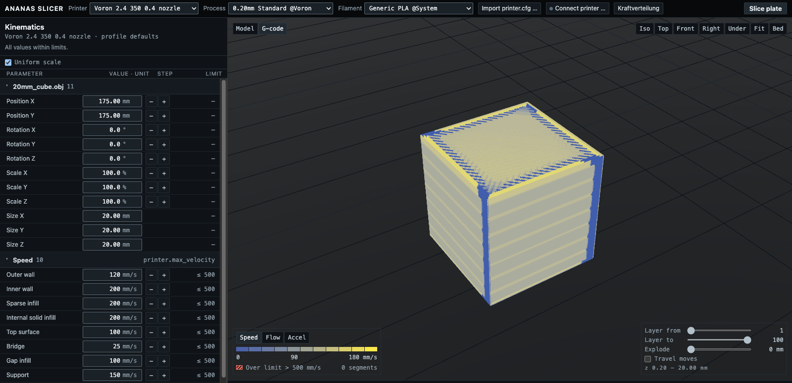
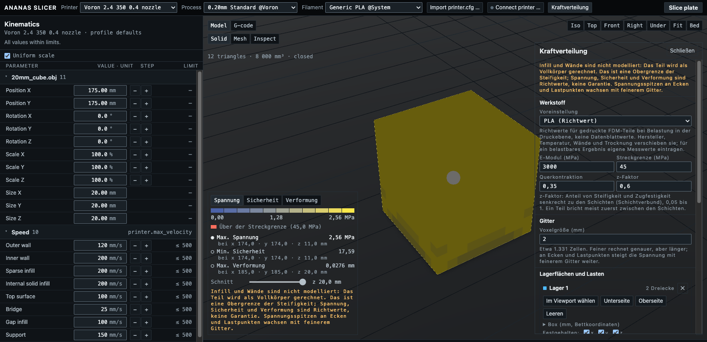

<p align="center">
  
</p>

<p align="center">
  <a href="https://github.com/Extrutex/ananas-slicer/actions/workflows/build_all.yml"></a>
  <a href="https://github.com/Extrutex/ananas-slicer/releases/latest"></a>
  <a href="LICENSE.txt"></a>
  <a href="https://extrutex.github.io/ananas-slicer-wiki/"></a>
  <a href="https://ko-fi.com/3dw_sebastianwindt"></a>
</p>

ANANAS SLICER is an open-source 3D printing slicer for printers that run
[Klipper](https://www.klipper3d.org/), and only for those. It is a hard fork of
OrcaSlicer with every path that does not lead to a Klipper machine removed: one
G-code flavor, one print host, no cloud, no login, no telemetry, and printer
profiles only for machines that verifiably run Klipper.

**Status: alpha.** The classic desktop app slices and prints; the new Cockpit UI
with force distribution is a developer preview that you build from source.
Details under [Status](#status).

| | |
|---|---|
| **Download** | [Latest release](https://github.com/Extrutex/ananas-slicer/releases/latest) for Windows, macOS and Linux |
| **Documentation** | [Wiki](https://extrutex.github.io/ananas-slicer-wiki/) in English and German |
| **Questions, prints, ideas** | [Discussions](https://github.com/Extrutex/ananas-slicer/discussions) |
| **Bugs** | [Issues](https://github.com/Extrutex/ananas-slicer/issues/new/choose) |
| **Support the project** | [Ko-fi](https://ko-fi.com/3dw_sebastianwindt) |

> ANANAS SLICER is an independent project and is not affiliated with or
> endorsed by the Klipper project.

## Download and install

Every release on the [releases page](https://github.com/Extrutex/ananas-slicer/releases)
carries these packages and a `SHA256SUMS.txt`:

| Platform | Package | First start |
|---|---|---|
| Windows 10 and 11, x64 and arm64 | `AnanasSlicer_Windows_V<version>_x64.exe` (or `_arm64.exe`), or `AnanasSlicer_Windows_V<version>_x64_portable.zip` to run without installing | SmartScreen warns about an unsigned program: **More info → Run anyway**. |
| macOS 12 or newer, Apple silicon and Intel | `AnanasSlicer_Mac_universal_V<version>.dmg` | The app is not notarized. macOS 15: open it once, then **System Settings → Privacy & Security → Open Anyway**. Or in a terminal: `xattr -dr com.apple.quarantine /Applications/AnanasSlicer.app` |
| Linux x86_64 | `AnanasSlicer_Linux_ubuntu_2404_V<version>.AppImage` | `chmod +x` and run. Needs FUSE 2 (`libfuse2`). |

The packages are unsigned because signing certificates cost money that the
project does not have yet; the first [Ko-fi](https://ko-fi.com/3dw_sebastianwindt)
goal is the Apple Developer Program. Flatpak, winget and Homebrew follow later.

ANANAS SLICER installs next to an existing OrcaSlicer and never reads or changes
its settings. If you used KLIPSLICE, your presets and printers are copied on the
first start; see the [migration page](https://extrutex.github.io/ananas-slicer-wiki/migration/).

## A first look

The classic app looks and works like the slicer it was forked from, with
everything that is not Klipper taken out. The Cockpit, the new interface that is
coming next, is built around one idea: the machine's limits are visible next to
every value, with the `printer.cfg` key they come from.

<p align="center">
  
</p>
<p align="center"><sub>Cockpit developer build on the virtual printer: every speed and acceleration next to the limit Klipper will enforce, and the G-code heatmap that marks anything above it.</sub></p>

<p align="center">
  
</p>
<p align="center"><sub>Force distribution: pick the faces that hold the part and the faces that carry the load, and see where the stress goes before you print. Guide values from a solid-body model, not a certificate.</sub></p>

## Why a Klipper-only slicer

Klipper executes the limits the G-code sets. Since April 2021 `SET_VELOCITY_LIMIT`
and `M204` are not clamped to the `max_accel`, `max_velocity` and
`square_corner_velocity` in `printer.cfg`: whatever the slicer writes is what the
machine does. The slicer is therefore the last place an envelope violation can be
caught, and ANANAS SLICER treats `printer.cfg` as the datum every emitted value is
checked against.

<p align="center">
  
</p>

## Where the G-code goes

Moonraker is the only print host. G-code upload, print start and printer
discovery on the LAN all go through Moonraker's own API and its
`_moonraker._tcp` Bonjour announcement; there are no vendor protocols and no cloud.
ANANAS SLICER opens no network connection at start; the only connections it makes
are the ones you configure to your Moonraker host.

<p align="center">
  
</p>

The G-code header names ANANAS SLICER and still carries OrcaSlicer's producer
line, because Moonraker's metadata parser recognises the dialect by that line and
would otherwise read neither print time nor thumbnails.

## What ANANAS SLICER is

- **Klipper only.** The G-code flavor is always `klipper`. Older projects and
  presets with another flavor are converted when they load. The G-code writer,
  print validation and the time estimate know one firmware.
- **Moonraker is the only print host.** Upload and print start go through
  [Moonraker](https://moonraker.readthedocs.io/). The host protocols inherited
  from OrcaSlicer (OctoPrint, PrusaLink, Duet, Creality, Elegoo, Flashforge and
  the cloud services) are removed, and so are the Bambu network plug-in, login,
  cloud provider, model mall and telemetry.
- **Profiles only for printers that verifiably run Klipper.** 174 printer models
  ship with a system profile, each one backed by per-model evidence (stock
  Klipper, Klipper via an established community conversion, or a self-built
  Klipper machine) in
  [`docs/ananas-slicer/printer-firmware.json`](docs/ananas-slicer/printer-firmware.json).
  Missing or wrong? Use the *Printer profile* issue form.
- **Your own printer is first-class.** Self-built and converted machines (for
  example a Marlin printer converted to Klipper) are set up with the
  **Generic Klipper Printer** profile or through the **Create printer** dialog.
  The flavor is always Klipper, the host always Moonraker.
- **Klipper-accurate print time.** The time estimate follows a model of Klipper's
  motion planning and is checked against Klipper's batch mode in the test suite.
- **Limits from `printer.cfg`.** The limits import reads `printer.cfg`, including
  includes and the `SAVE_CONFIG` block, the way Klipper does, or takes them live
  from Moonraker.
- **Side by side with OrcaSlicer.** ANANAS SLICER uses its own binaries and its own
  data directory and never reads or changes an installed OrcaSlicer.

## Force distribution (developer preview)

The Cockpit can run a linear stress analysis on the part you are about to print:
pick the faces that hold it and the faces that carry a load, give the load in
newtons, and the engine solves a voxel model of the part (hexahedral elements,
matrix-free conjugate gradient with a geometric multigrid preconditioner) and
colours it by von Mises stress, safety factor or displacement. The material model
is anisotropic in Z, so the weak layer bond of an FDM part is in the numbers.

Be honest with yourself about what it is: the part is computed as a solid body,
which is an upper bound of its stiffness (walls and infill are not modelled), and
stress peaks at sharp inside corners grow with finer grids, as in every finite
element model. The solver was validated against a tension bar, a cantilever,
three-point bending, a thick tube under pressure, a plate with a hole and an
L bracket; the measured errors are in the
[wiki](https://extrutex.github.io/ananas-slicer-wiki/stress/). Use it to compare
orientations and wall counts, not to certify a part.

## Status

**Classic app (the release packages):** slicing, printer and filament profiles,
calibration dialogs, Moonraker upload and print, printer discovery, `printer.cfg`
limits import. Known gaps in this alpha: the packages are unsigned, some help
links lead to wiki pages that are still being written, and most translations are
inherited and not yet reviewed.

**Cockpit and engine (built from source):** load a model (STL, OBJ, 3MF, AMF,
STEP), slice, save the G-code, connect a Moonraker printer, upload, print,
monitor and cancel, in one window; `printer.cfg` import; every limit next to its
value; 3D viewport with three views and an exploded view; G-code heatmaps; force
distribution. Not yet: packaging, editing anything beyond speeds, accelerations
and pressure advance (the rest comes from the preset), thumbnails, cancelling a
running slice, and, above all, a run on a real printer. Everything so far was
tested against the virtual printer only.

Every push is built and tested automatically for Windows, macOS and Linux.

## The kinematics ANANAS SLICER knows

Every machine profile names the Klipper `kinematics` it runs on. The figures show
what moves, what stands still and which motors share a move; the full notes are in
[`docs/ananas-slicer/kinematics.md`](docs/ananas-slicer/kinematics.md).

<table>
  <tr>
    <td width="50%"></td>
    <td width="50%"></td>
  </tr>
  <tr>
    <td><b>CoreXY</b> &middot; <code>kinematics: corexy</code><br>Voron, RatRig V-Core 3, most self-built machines. Every XY move splits across motor A and motor B.</td>
    <td><b>CoreXY AWD</b> &middot; <code>[stepper_x1] [stepper_y1]</code><br>RatRig V-Core 4, Voron AWD mods. Same belt path, two steppers per belt.</td>
  </tr>
  <tr>
    <td></td>
    <td></td>
  </tr>
  <tr>
    <td><b>Cartesian</b> &middot; <code>kinematics: cartesian</code><br>Prusa-i3 layout, Ender conversions. Y acceleration is bounded by the mass of bed plus print.</td>
    <td><b>CoreXZ</b> &middot; <code>kinematics: corexz</code><br>Voron Switchwire, Ender 5 conversions. CoreXY turned on its side.</td>
  </tr>
  <tr>
    <td></td>
    <td></td>
  </tr>
  <tr>
    <td><b>Delta</b> &middot; <code>kinematics: delta</code><br>FLSun V400, T1 and S1, DeltaMaker. One velocity and acceleration limit for all axes, circular bed.</td>
    <td><b>IDEX</b> &middot; <code>[dual_carriage]</code><br>RatRig V-Core 4 IDEX. Two heads on one rail; Klipper's COPY and MIRROR modes print two parts at once.</td>
  </tr>
</table>

## Roadmap

In this order, without dates:

1. **Cockpit as a package** for Windows, macOS and Linux, with the engine
   bundled, a full settings editor and the force distribution. Until then the
   classic app is the daily driver.
2. **Runs on real printers.** The Cockpit has only seen the virtual printer.
3. **Machine sync in the classic app, too:** the live Klipper configuration
   (`max_accel`, `max_velocity`, `square_corner_velocity`,
   `minimum_cruise_ratio`, input shaper) next to every value, as the Cockpit
   already does.
4. **The rest of the chain.** A Moonraker-compatible print server in Rust and,
   much later, an own firmware are in development next door. ANANAS SLICER talks
   to them the same way it talks to Moonraker today; nothing of that has run on
   hardware yet.

The full roadmap, and what is deliberately out of scope, is in the
[wiki](https://extrutex.github.io/ananas-slicer-wiki/roadmap/).

## Build from source

Every platform builds in two steps: first the dependencies (`deps/`, built once
and reused), then the slicer. The dependency build takes a long time and needs
several gigabytes of disk space. Run any build script with `-h` for all options.

```bash
git clone https://github.com/Extrutex/ananas-slicer.git
cd ananas-slicer
```

### Windows

Requires Visual Studio 2019, 2022 or 2026, CMake, Perl and Git.

```bat
build_win.bat -d
build_win.bat -s
```

Output: `build\src\Release\ananas-slicer.exe`

### macOS

Requires Xcode or the Command Line Tools, CMake 3.31 and gettext.
CMake 4.x currently breaks the dependency build; use CMake 3.31.

With the Command Line Tools only (no full Xcode), export the SDK path first:

```bash
export SDKROOT=$(xcrun --show-sdk-path)
```

Then build the dependencies and the slicer with the Ninja generator:

```bash
./build_release_macos.sh -dx
./build_release_macos.sh -sx
```

Output: `build/<arch>/OrcaSlicer/AnanasSlicer.app` (`<arch>` is `arm64` or `x86_64`;
the directory name is inherited from the build scripts)

Two environment variables adjust a single-arch build:

- `ANANAS_SLICER_OSX_SYSROOT` sets the SDK for both the dependency and the slicer
  configure, as a path (relative paths resolve against the current directory)
  or an SDK name such as `macosx26.5`. Without it, the slicer compiles against
  the same SDK as its dependencies: the deps build records the SDK path and
  version in `deps/build/<arch>/OrcaSlicer_dep/ananas-slicer-sdk.txt`, and the
  slicer configure uses that path, or the installed SDK of the same version if
  the path does not exist on this machine. Older deps trees without the record
  fall back to the `CMAKE_OSX_SYSROOT` of `deps/build/<arch>/CMakeCache.txt`.
  A newer SDK declares APIs newer than the deployment target, and
  `-Werror=unguarded-availability-new` then fails the build. If no matching SDK
  is found, CMake picks its default SDK and the script prints a warning.
- `ANANAS_SLICER_BUILD_DIR` moves the slicer build tree, including the packaged
  app, from `build/<arch>` to another directory (absolute or relative to the
  repository). It cannot be combined with universal builds, which lipo the
  fixed `build/arm64` and `build/x86_64` trees.

```bash
ANANAS_SLICER_BUILD_DIR=build/arm64-ws ./build_release_macos.sh -sx -a arm64
```

### Linux

Requires more than 10 GiB of available memory and free disk space.

```bash
./build_linux.sh -u      # install system dependencies (asks for sudo)
./build_linux.sh -dsi    # dependencies, slicer and AppImage
```

Output: `build/package/bin/ananas-slicer` and `build/AnanasSlicer_Linux_V<version>.AppImage`

### Cockpit and engine

The engine (`src/engine/`, target `ananas-engine`) builds with the slicer. The
Cockpit lives in `ui/` (Node and Rust toolchains required) and is documented in
[`docs/HLSD/ui.md`](docs/HLSD/ui.md) and
[`docs/HLSD/engine.md`](docs/HLSD/engine.md); the wiki's
[build page](https://extrutex.github.io/ananas-slicer-wiki/build/) walks through it.

## Support the project

ANANAS SLICER is free software made by one person in the evenings. If it saves
you a failed print, a coffee on [Ko-fi](https://ko-fi.com/3dw_sebastianwindt)
keeps it going. The money goes, in this order, to:

1. the Apple Developer Program, so that the macOS packages are signed and
   notarized and open without a detour through the security settings;
2. a domain for the documentation;
3. a test printer and a control board, so that the print server and the
   firmware that ANANAS SLICER is meant to drive can run on real hardware.

## Community and contributing

Questions, prints and ideas go to [Discussions](https://github.com/Extrutex/ananas-slicer/discussions),
bugs and crashes to the [issue forms](https://github.com/Extrutex/ananas-slicer/issues/new/choose),
security problems [privately](SECURITY.md). The [Code of Conduct](CODE_OF_CONDUCT.md)
applies everywhere.

ANANAS SLICER has a single maintainer. Bug reports and printer evidence are always
welcome; code changes are accepted only after they were agreed in an issue first.
See [CONTRIBUTING.md](CONTRIBUTING.md) and [SUPPORT.md](SUPPORT.md).

## Credits and license

ANANAS SLICER is based on [OrcaSlicer](https://github.com/OrcaSlicer/OrcaSlicer) by
SoftFever and the OrcaSlicer contributors. OrcaSlicer is based on
[Bambu Studio](https://github.com/bambulab/BambuStudio) by Bambu Lab, which is
based on [PrusaSlicer](https://github.com/prusa3d/PrusaSlicer) by Prusa Research,
which comes from [Slic3r](https://github.com/Slic3r/Slic3r) by Alessandro
Ranellucci and the RepRap community. ANANAS SLICER would not exist without their work.

ANANAS SLICER is licensed under the **GNU Affero General Public License, version 3**.
See [LICENSE.txt](LICENSE.txt) and [NOTICE](NOTICE). Anyone who distributes
ANANAS SLICER, modified or not, must make the corresponding source code available
under the same terms; the source of every release is its Git tag.
