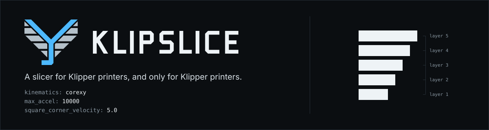
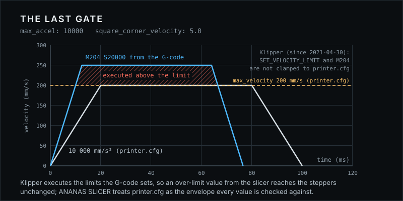
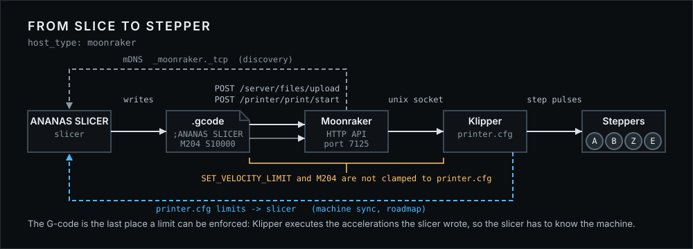
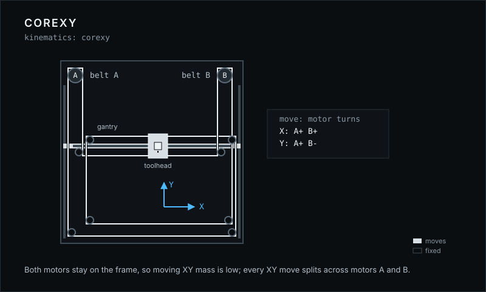
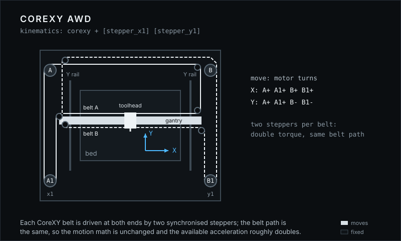
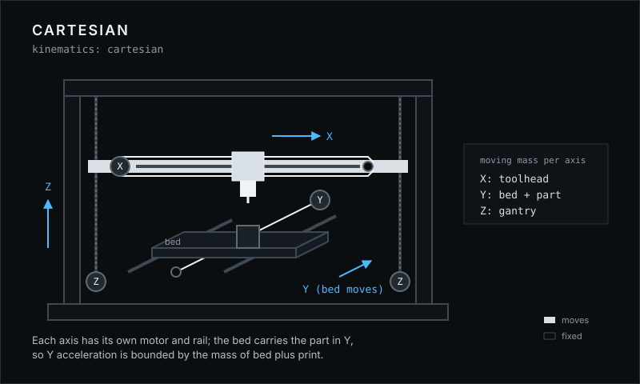
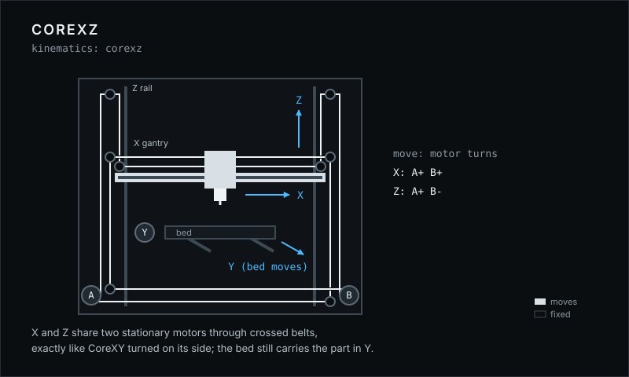
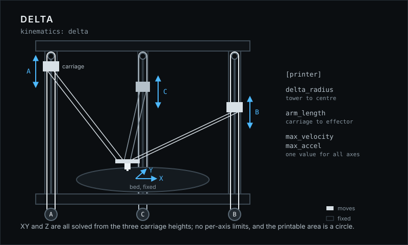
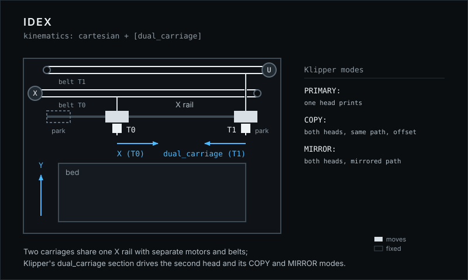

<p align="center">
  
</p>

ANANAS SLICER is an open-source 3D printing slicer built exclusively for printers that
run real [Klipper](https://www.klipper3d.org/). It is a hard fork of OrcaSlicer with
every path that does not lead to a Klipper machine removed: one G-code flavor, one
print host, and printer profiles only for machines that verifiably run Klipper.

**Documentation:** <https://extrutex.github.io/KlipSlice-Wiki/> (English and German)

> ANANAS SLICER is an independent project and is not affiliated with or
> endorsed by the Klipper project.

## Why a Klipper-only slicer

Klipper executes the limits the G-code sets. Since April 2021 `SET_VELOCITY_LIMIT`
and `M204` are not clamped to the `max_accel`, `max_velocity` and
`square_corner_velocity` in `printer.cfg`: whatever the slicer writes is what the
machine does. The slicer is therefore the last place an envelope violation can be
caught, and ANANAS SLICER treats `printer.cfg` as the datum every emitted value is
checked against.

<p align="center">
  
</p>

## Where the G-code goes

Moonraker is the only print host. G-code upload, print start and printer
discovery on the LAN all go through Moonraker's own API and its
`_moonraker._tcp` Bonjour announcement; there are no vendor protocols and no cloud.

<p align="center">
  
</p>

## What ANANAS SLICER is

- **Klipper only.** The G-code flavor is always `klipper`. Older projects and
  presets with another flavor are converted when they load.
- **Moonraker is the only print host.** Upload and print start go through
  [Moonraker](https://moonraker.readthedocs.io/). The host protocols inherited
  from OrcaSlicer (OctoPrint, PrusaLink, Duet, Creality, Elegoo, Flashforge and
  the cloud services) are removed, and so are the Bambu network plug-in, login,
  cloud provider, model mall and telemetry.
- **Profiles only for printers that verifiably run Klipper.** 174 printer models
  ship with a system profile, each one backed by per-model evidence (stock
  Klipper, Klipper via an established community mod, or a self-built Klipper
  machine) in
  [`docs/ananas-slicer/printer-firmware.json`](docs/ananas-slicer/printer-firmware.json).
- **Your own printer is first-class.** Self-built and converted machines (for
  example a Marlin printer converted to Klipper) are set up with the
  **Generic Klipper Printer** profile or through the **Create printer** dialog.
  The flavor is always Klipper, the host always Moonraker.
- **Side by side with OrcaSlicer.** ANANAS SLICER uses its own binaries and its own
  data directory and never reads or changes an installed OrcaSlicer.

## The kinematics ANANAS SLICER knows

Every machine profile names the Klipper `kinematics` it runs on. The figures show
what moves, what stands still and which motors share a move; the full notes are in
[`docs/ananas-slicer/kinematics.md`](docs/ananas-slicer/kinematics.md).

<table>
  <tr>
    <td width="50%"></td>
    <td width="50%"></td>
  </tr>
  <tr>
    <td><b>CoreXY</b> &middot; <code>kinematics: corexy</code><br>Voron, RatRig V-Core 3, most self-built machines. Every XY move splits across motor A and motor B.</td>
    <td><b>CoreXY AWD</b> &middot; <code>[stepper_x1] [stepper_y1]</code><br>RatRig V-Core 4, Voron AWD mods. Same belt path, two steppers per belt.</td>
  </tr>
  <tr>
    <td></td>
    <td></td>
  </tr>
  <tr>
    <td><b>Cartesian</b> &middot; <code>kinematics: cartesian</code><br>Prusa-i3 layout, Ender conversions. Y acceleration is bounded by the mass of bed plus print.</td>
    <td><b>CoreXZ</b> &middot; <code>kinematics: corexz</code><br>Voron Switchwire, Ender 5 conversions. CoreXY turned on its side.</td>
  </tr>
  <tr>
    <td></td>
    <td></td>
  </tr>
  <tr>
    <td><b>Delta</b> &middot; <code>kinematics: delta</code><br>FLSun V400, T1 and S1, DeltaMaker. One velocity and acceleration limit for all axes, circular bed.</td>
    <td><b>IDEX</b> &middot; <code>[dual_carriage]</code><br>RatRig V-Core 4 IDEX. Two heads on one rail; Klipper's COPY and MIRROR modes print two parts at once.</td>
  </tr>
</table>

## Vision

ANANAS SLICER aims at machine-aware slicing: a slicer that knows the machine it
slices for. The following is **roadmap, not implemented yet**:

- **Machine sync.** Read the live Klipper configuration through Moonraker
  (`max_accel`, `max_velocity`, `square_corner_velocity`,
  `minimum_cruise_ratio`, input shaper) and plan against the real limits of the
  connected printer instead of values typed into a profile.
- **Klipper-accurate print time.** Estimate print time with Klipper's own motion
  model instead of a generic approximation.
- **Native adaptive mesh.** Probe only the area that is actually printed, without
  separate macro packages.

## Status

**Pre-alpha.** There are no releases and no installers yet. Settings, profiles
and file formats can still change without migration. Do not rely on ANANAS SLICER for
prints that matter.

Every push is built and tested automatically for Windows, macOS and Linux.

## Build from source

Every platform builds in two steps: first the dependencies (`deps/`, built once
and reused), then the slicer. The dependency build takes a long time and needs
several gigabytes of disk space. Run any build script with `-h` for all options.

```bash
git clone https://github.com/Extrutex/KlipSlice.git
cd KlipSlice
```

### Windows

Requires Visual Studio 2019, 2022 or 2026, CMake, Perl and Git.

```bat
build_win.bat -d
build_win.bat -s
```

Output: `build\src\Release\ananas-slicer.exe`

### macOS

Requires Xcode or the Command Line Tools, CMake 3.31 and gettext.
CMake 4.x currently breaks the dependency build; use CMake 3.31.

With the Command Line Tools only (no full Xcode), export the SDK path first:

```bash
export SDKROOT=$(xcrun --show-sdk-path)
```

Then build the dependencies and the slicer with the Ninja generator:

```bash
./build_release_macos.sh -dx
./build_release_macos.sh -sx
```

Output: `build/<arch>/OrcaSlicer/AnanasSlicer.app` (`<arch>` is `arm64` or `x86_64`)

Two environment variables adjust a single-arch build:

- `ANANAS_SLICER_OSX_SYSROOT` sets the SDK for both the dependency and the slicer
  configure, as a path (relative paths resolve against the current directory)
  or an SDK name such as `macosx26.5`. Without it, the slicer compiles against
  the same SDK as its dependencies: the deps build records the SDK path and
  version in `deps/build/<arch>/OrcaSlicer_dep/ananas-slicer-sdk.txt`, and the
  slicer configure uses that path, or the installed SDK of the same version if
  the path does not exist on this machine. Older deps trees without the record
  fall back to the `CMAKE_OSX_SYSROOT` of `deps/build/<arch>/CMakeCache.txt`.
  A newer SDK declares APIs newer than the deployment target, and
  `-Werror=unguarded-availability-new` then fails the build. If no matching SDK
  is found, CMake picks its default SDK and the script prints a warning.
- `ANANAS_SLICER_BUILD_DIR` moves the slicer build tree, including the packaged
  app, from `build/<arch>` to another directory (absolute or relative to the
  repository). It cannot be combined with universal builds, which lipo the
  fixed `build/arm64` and `build/x86_64` trees.

```bash
ANANAS_SLICER_BUILD_DIR=build/arm64-ws ./build_release_macos.sh -sx -a arm64
```

### Linux

Requires more than 10 GiB of available memory and free disk space.

```bash
./build_linux.sh -u      # install system dependencies (asks for sudo)
./build_linux.sh -dsi    # dependencies, slicer and AppImage
```

Output: `build/package/bin/ananas-slicer` and `build/AnanasSlicer_Linux_V<version>.AppImage`

## Contributing

ANANAS SLICER has a single maintainer. Bug reports are welcome; code changes are
accepted only after they were agreed in an issue first. See
[CONTRIBUTING.md](CONTRIBUTING.md).

## Credits and license

ANANAS SLICER is based on [OrcaSlicer](https://github.com/OrcaSlicer/OrcaSlicer) by
SoftFever and the OrcaSlicer contributors. OrcaSlicer is based on
[Bambu Studio](https://github.com/bambulab/BambuStudio) by Bambu Lab, which is
based on [PrusaSlicer](https://github.com/prusa3d/PrusaSlicer) by Prusa Research,
which comes from [Slic3r](https://github.com/Slic3r/Slic3r) by Alessandro
Ranellucci and the RepRap community. ANANAS SLICER would not exist without their work.

ANANAS SLICER is licensed under the **GNU Affero General Public License, version 3**.
See [LICENSE.txt](LICENSE.txt). Anyone who distributes ANANAS SLICER, modified or not,
must make the corresponding source code available under the same terms.
